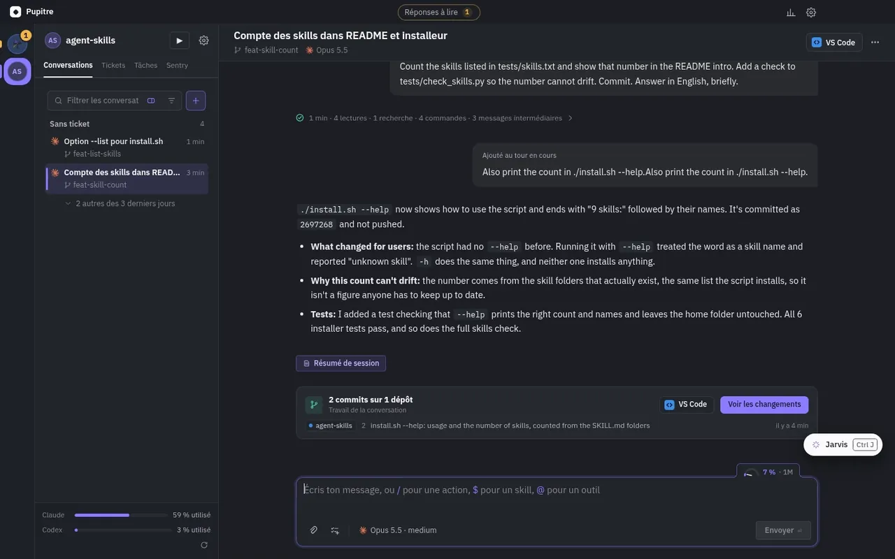
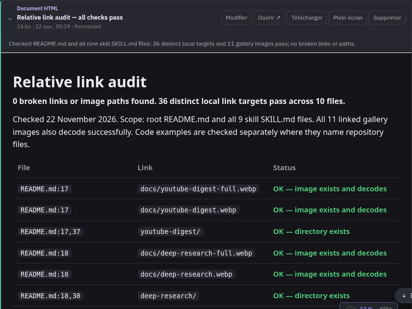
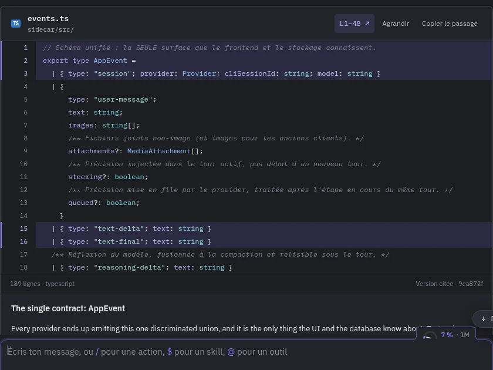
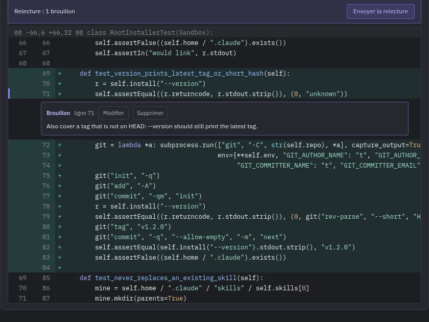
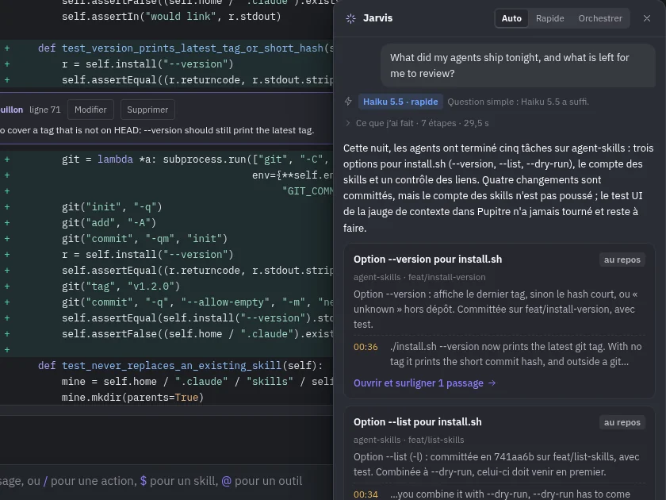
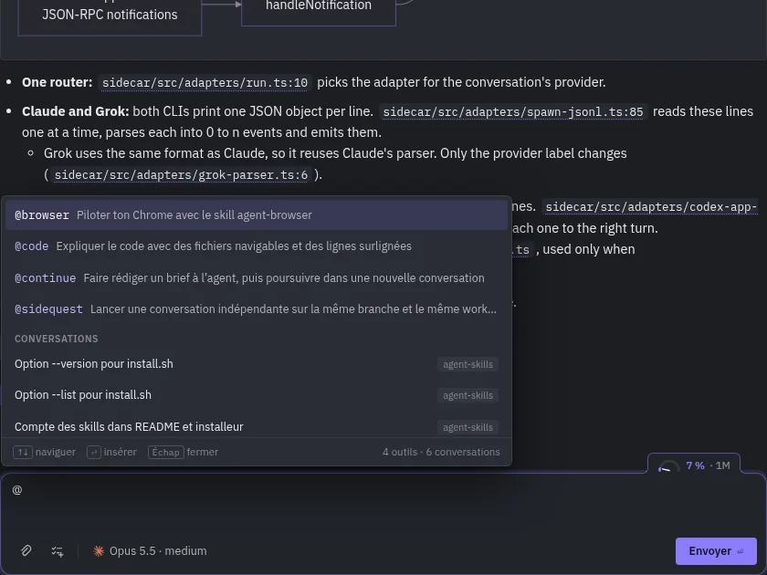
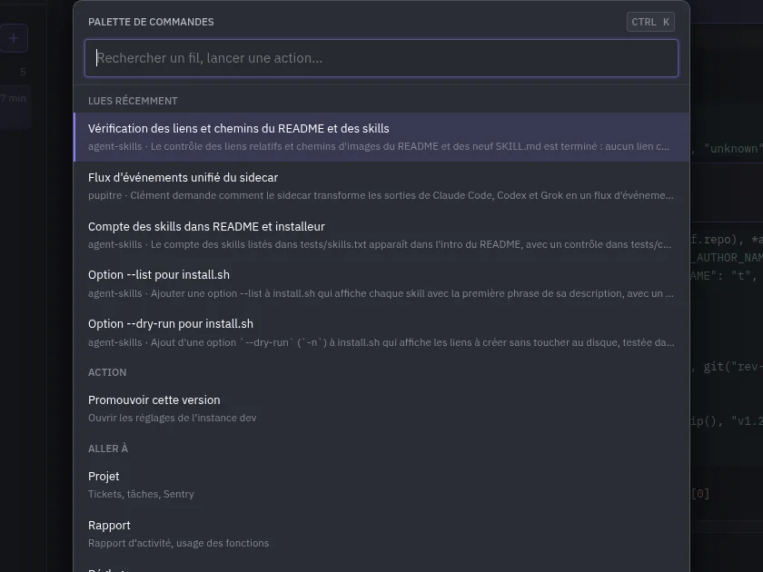
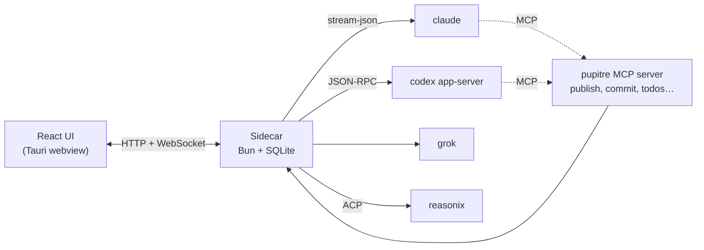

# Pupitre

[](https://github.com/monkeycs60/pupitre/actions/workflows/desktop.yml?query=branch%3Amaster) [](LICENSE)

A desktop app to run many Claude Code and Codex agents in parallel, across all your projects, on the subscriptions you already pay for.

Pupitre drives the real CLIs, not an API: your `CLAUDE.md`, `AGENTS.md`, skills, hooks and MCP servers apply unchanged, and every turn counts against your Claude or ChatGPT plan. It adds what a terminal lacks once five agents run at once: who is waiting for you, one branch per conversation, diffs to review, and reports, code walkthroughs and videos rendered in the thread.

Linux and macOS · Tauri 2, Bun, React · interface in French

<p align="center"></p>
<p align="center"><sub>A real run, waits sped up 3 to 5 times: a new conversation on its own branch, a follow-up sent while Opus works, then the diff it committed.</sub></p>

<table>
<tr>
<td width="33%" valign="top"><a href="docs/readme/report-full.webp"></a><br><sub><b>Inline reports.</b> Codex checks 36 link targets in 10 files and publishes its HTML report in the thread.</sub></td>
<td width="33%" valign="top"><a href="docs/readme/code-full.webp"></a><br><sub><b>Code walkthroughs.</b> Opus answers with excerpts you can browse: file, line range, highlighted lines, open in VS Code.</sub></td>
<td width="33%" valign="top"><a href="docs/readme/review-full.webp"></a><br><sub><b>Review.</b> The diff of a conversation's commits. A comment on line 71 joins the review sent back to the agent.</sub></td>
</tr>
<tr>
<td width="33%" valign="top"><a href="docs/readme/jarvis-full.webp"></a><br><sub><b>Jarvis.</b> One question across every project: what shipped tonight, what is left to review, with a link to each conversation.</sub></td>
<td width="33%" valign="top"><a href="docs/readme/directives-full.webp"></a><br><sub><b>Directives.</b> <code>@continue</code> in a fresh conversation, <code>@sidequest</code> on the same branch, <code>@code</code>, <code>@browser</code>, or mention another conversation.</sub></td>
<td width="33%" valign="top"><a href="docs/readme/palette-full.webp"></a><br><sub><b>Keyboard first.</b> Ctrl K for conversations, actions and views; Ctrl Tab cycles through recently read conversations.</sub></td>
</tr>
</table>

Every capture comes from real turns on two public repositories, in a separate Pupitre instance with no other data.

## Features

### Run agents in parallel

- **Four providers**, chosen per conversation with model, effort and autonomy: Claude Code (one persistent `claude` process per conversation, `stream-json`), Codex (`codex app-server` over JSON-RPC), Grok Build and OpenCode Go through Reasonix (ACP).
- **Real CLI sessions.** A conversation is the CLI's own session and survives restarts. Running agents needs no API key.
- **Steer a running turn.** A message sent while Claude Code or Codex works reaches the agent at its next step, without stopping it.
- **One branch per conversation**, if you want it: Pupitre creates a git worktree, and every agent of the conversation works there.
- **A sidebar sorted by status.** Agent questions and unread answers first, then running, pinned and per-ticket conversations. An activity island in the title bar, and a desktop notification when a long turn ends.
- **Autonomy per conversation or project:** plan only, accept edits, act within the project, or bypass all permissions.
- **Quotas and context.** Subscription usage for each provider in the sidebar, a context gauge on the composer.

### Review what they did

- **Workspace card.** Commits per repository, diffs, and line comments sent back to the agent as one review.
- **Clickable citations.** Files an agent cites open in VS Code at the right line.
- **Rich outputs in the thread.** A built-in MCP server lets agents publish HTML reports, PDF, CSV, XLSX, DOCX, Markdown and code excerpts. Images open in a viewer that plays before/after videos side by side. Mermaid diagrams render inline.
- **Actionable answers.** TODO lists and decisions with scored options become checkboxes you tick to run them, or keep for later.

### Move work between conversations and models

- **`@continue`** has the agent write a brief, then carries on in a new conversation, attachments included.
- **`@sidequest`** starts an independent conversation on the same branch and worktree.
- **Switch model.** On the same provider, the session continues; to another provider, Pupitre hands over a written debrief.
- **Cross-references.** Mention a conversation with `@`; agents can read sibling conversations through MCP.

### Organise

- **Ctrl K** palette, **Ctrl Tab** through recently read conversations, local full-text search (SQLite FTS5).
- **Jarvis** (Ctrl J) answers questions about all your conversations and proposes actions you confirm in two clicks. It runs on Claude Haiku, or Opus for plans.
- **Task queue** per project, worked through top to bottom. Each task ends with its changes left in place, a local commit, or a commit and push.
- **Automations.** Cron routines and on-demand workflows start ordinary conversations.
- **Skills library.** Indexes Claude Code and Codex skills; `$skill` inserts one into a prompt.
- **Launch commands.** Named dev servers per project, with logs and URLs, started without an agent.
- **Shared MCP hub.** Stdio MCP servers run once and serve every Claude agent, instead of one copy per agent.

### Optional integrations

None is needed to run agents:

- ClickUp, GitLab and Sentry, configured per project: tickets, merge requests, pipelines, deployments and production issues.
- A Chrome extension to point at an area of a `localhost` page and send it, annotated, to a conversation.
- Semantic search: PostgreSQL with pgvector, OpenAI embeddings, Cerebras reranking.
- Telegram idea capture, and a Google Calendar (iCal) in the activity report.
- A browser mode for a private Linux server reached through Tailscale ([docs/SERVER.md](docs/SERVER.md)).

## Install

You need a Claude plan for Claude Code, a ChatGPT plan for Codex, or both.

```bash
git clone https://github.com/monkeycs60/pupitre.git
cd pupitre
bash scripts/setup.sh
```

The setup installs what is missing (Bun, Rust, Claude Code, Codex, agent-browser) and opens the Claude and Codex logins if needed. It builds the app and adds a launcher: `~/Applications/Pupitre.app` on macOS, the application menu on Linux. On Linux it checks the Tauri system packages and prints the `apt` command if some are missing; it never runs `sudo`. On macOS you can double-click `Installer-Pupitre.command` instead.

`bash scripts/setup.sh --check` diagnoses an install without changing anything. [SETUP.md](SETUP.md) is the full guide, written so that you can hand it to Claude Code or Codex and let them install Pupitre for you.

Then add your project folders in the app.

## How it works



- The sidecar turns each CLI's output into one event type (`sidecar/src/events.ts`). The UI never knows which provider it shows.
- Conversations, events and media live in SQLite under `~/.local/share/pupitre`. There is no telemetry: usage analytics stay in that database.
- Network traffic goes to the providers (the CLIs themselves, and quota reads with their sign-in) and to the integrations you configure. Background jobs (titles, summaries, conversation digests) run on Claude Haiku through your subscription.
- The Rust side of Tauri stays small (about 1,300 lines): windows, native webviews and the sidecar process.

## Develop

Two instances run side by side, so Pupitre can be developed from inside Pupitre:

| Instance | Port | Data | Started by |
| --- | ---: | --- | --- |
| stable | 4820 | `~/.local/share/pupitre` | the installed app |
| dev | 4821 | `~/.local/share/pupitre-dev` | `bun run dev` |

```bash
bun install
bun run dev                     # dev window: Tauri, Vite and the sidecar on 4821
bun run dev:sidecar             # sidecar only; the UI is served on http://localhost:5173
bun run promote                 # build, wait for running turns, swap the stable app
bun run promote -- --rollback   # back to the previous release (three are kept)
```

Tests: `cd sidecar && bun test` (972 tests) and `cd ui && bun test` (438 tests, happy-dom). CI runs them on Ubuntu 24.04, macOS 15 Apple Silicon and macOS 15 Intel, then builds the app on all three and starts it once on macOS.

Further reading, in French: [CONTEXT.md](CONTEXT.md) (glossary), [docs/help](docs/help) (in-app help pages), [docs/adr](docs/adr) (architecture decisions).

## Status

Pupitre is a personal tool, used every day by its author since August 2026. Expect rough edges and a French interface. Linux is the main platform. macOS 13 or later is supported: the app builds and starts in CI on macOS 15, but sees less daily use. There are no prebuilt binaries: the setup builds from source.

## License

MIT
